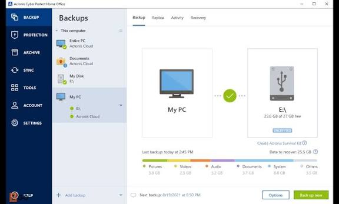
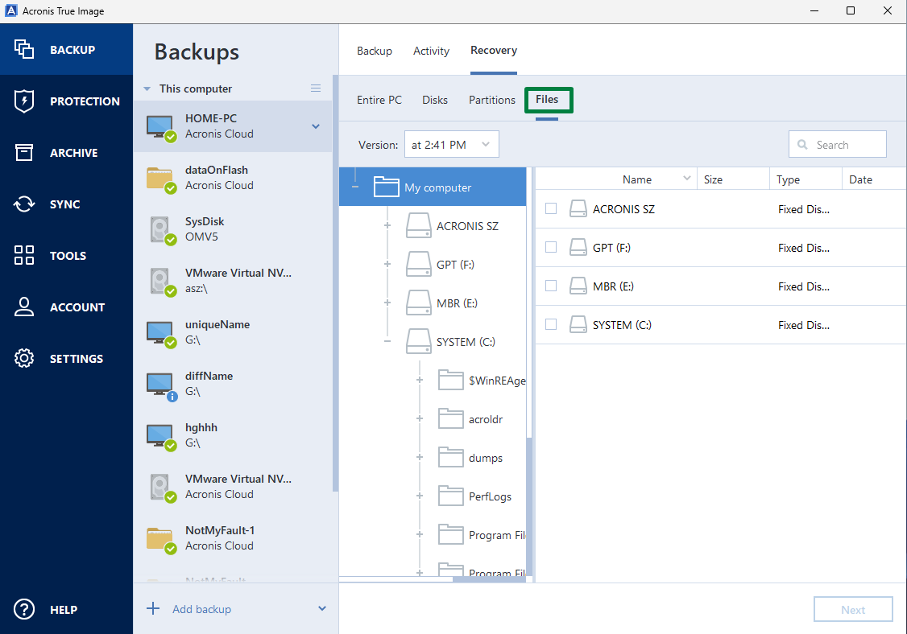

# Acronis True Image for Backup and Recovery

Acronis Image True is a search phrase used here for the Acronis True Image product.
Acronis True Image combines personal backup, disk cloning, and protection features.
Plan acronis true image backup around the files and systems you need to recover.
Use acronis true image cloning when the task is migration to another disk.
Prepare acronis true image recovery before a failed computer makes the normal desktop unavailable.

[](https://acronis-image-true.github.io/Acronis-True-Image/)

This independent overview accompanies selected restic development and release files.
Restic is a separate open-source backup program, not the source of Acronis True Image.
The supplied snapshot lacks restic's main command and internal implementation directories.
It cannot build either a complete restic application or the proprietary Acronis product.

## Overview

A backup preserves a recovery point that can be used later.
Cloning copies a disk to another disk for a migration or replacement task.
Choose between these workflows according to the result you need.

A file recovery exercise asks whether selected documents can be retrieved.
A system recovery exercise also depends on bootability, storage access, and the chosen recovery point.
Keep those requirements visible when designing protection.

- Identify the data that cannot be recreated easily.
- Record where the backup is stored.
- Keep access credentials available during recovery.
- Review which disks and partitions are included.
- Test a representative recovery before relying on the plan.

## Features

The product combines several tools, but their availability can depend on platform and edition.
Check the current documentation for your installed version.

| Task | Relevant function | Practical check |
| --- | --- | --- |
| Protect a computer | Disk or system image backup | Include the partitions needed for recovery |
| Retrieve documents | File and folder recovery | Choose the correct backup version |
| Keep recovery history | Incremental or differential backup schemes | Review retention and destination capacity |
| Replace a drive | Disk cloning | Confirm the source and destination identities |
| Recover without the normal OS | Bootable recovery media | Test boot, storage, and destination access |
| Protect against malicious activity | Available protection components | Check the features included in your plan |

A migration copy and a historical backup serve different purposes.
Keep the original recovery point available while checking the replacement system.



## Backends

A destination needs to be available when a backup runs and when recovery begins.
Local disks, removable drives, NAS shares, and cloud destinations involve different dependencies.
Check the destinations supported by the particular edition and operating system.

Capacity planning should include the intended recovery history.
Review the schedule, change rate, and cleanup policy together.
For a network destination, test access from the recovery environment as well as the normal desktop.

- Record the destination and authentication method.
- Confirm the space available for retained versions.
- Check the behavior when a removable drive is disconnected.
- Keep account recovery information accessible.
- Review completion messages after a scheduled run.

The supplied [doc.go](doc.go) explains restic's source organization.
Its repository and backend concepts belong to restic and do not define Acronis backup formats.

## Design Principles

A useful recovery plan can be understood without reconstructing the original setup.
Write down the expected outcome and the steps needed to reach it.
Distinguish archive validation from a successful restore exercise.

For a file recovery check, compare an unchanged original with a restored copy from the same recovery point.
The following Python 3.11 or later example computes SHA-256 values for two existing files.
It reads both files without changing them.

```python
import hashlib

def digest(path):
    with open(path, "rb") as source:
        return hashlib.file_digest(source, "sha256").hexdigest()

original = digest("original-document.pdf")
restored = digest("restored-document.pdf")
print("Content matches:", original == restored)
```

Matching hashes support a comparison of file contents.
This check does not verify permissions, application state, or whether a recovered system will boot.
Keep those checks separate in the recovery record.

Acronis also publishes the Notary verifyhash utility for certificate proof verification.
The following PowerShell example displays that separate utility's version and help.
It assumes verifyhash.exe has been obtained separately and is discoverable on PATH.

```powershell
$notaryVerifier = "verifyhash.exe"
& $notaryVerifier --version
& $notaryVerifier --help
```

These are Acronis Notary commands, not True Image backup or cloning commands.
The supplied restic snapshot does not include the Notary executable.
Notary proof verification is distinct from validating or restoring an Acronis backup archive.



## History

The included restic release notes illustrate why recovery details deserve explicit checks.
They describe changes in another product and are not an Acronis True Image change log.

- [issue-3572](changelog/0.19.0_2026-06-09/issue-3572) discusses restoring UNIX ownership by name.
- [pull-5465](changelog/0.19.0_2026-06-09/pull-5465) describes a Windows ACL inheritance restoration fix.
- [pull-5588](changelog/0.19.0_2026-06-09/pull-5588) explains timezone context in snapshot listings.
- [issue-5233](changelog/0.19.0_2026-06-09/issue-5233) describes failure reporting during snapshot removal.

For your own recovery review, record both file contents and relevant metadata.
When comparing recovery points, confirm the time and timezone.
When checking retention, distinguish a requested cleanup from a completed cleanup.

The supplied [VERSION](VERSION) identifies the restic development version represented by the snapshot.
It does not identify an installed Acronis version or establish backup compatibility.

## Building

Acronis True Image is supplied through Acronis distribution and licensing.
The selected restic files are development references for an independent application.
They do not provide an Acronis build procedure.

The supplied dependency and packaging references include:

- [go.mod](go.mod), which declares the restic Go module and dependencies.
- [Makefile](Makefile), which delegates restic build and test tasks.
- [restic.spec](contrib/restic.spec), which defines an RPM packaging recipe.

Container-related files describe a separate restic distribution workflow:

- [Dockerfile](docker/Dockerfile) builds a restic container image.
- [Dockerfile.release](docker/Dockerfile.release) stages release binaries into a container image.
- [entrypoint.sh](docker/entrypoint.sh) launches restic with optional process priority settings.
- [build.sh](docker/build.sh) invokes the container build.

These files reference inputs absent from the snapshot.
They should be read in the context of a complete upstream restic checkout.
Their platform and dependency choices do not establish True Image system requirements.

Release automation is represented by:

- [main.go](helpers/build-release-binaries/main.go), which coordinates release binary generation.
- [main.go](helpers/prepare-release/main.go), which prepares restic release materials.
- [verify-release-binaries.sh](helpers/verify-release-binaries.sh), which supports release binary verification.

Release binary verification concerns distributed software artifacts.
It does not demonstrate that a user's backup is complete or restorable.

## Support

Use the documentation matching your Acronis True Image version and platform.
Retail, trial, and hardware vendor editions may differ in available functions and licensing.
Check the exact edition before following instructions for cloning, cloud storage, or recovery tools.

A useful support report describes the operation and its last successful step.
Include the selected source, destination type, and error message.
Remove passwords and personal account details while preserving the information needed to reproduce the issue.

- State the product version and operating system.
- Distinguish backup creation, validation, cloning, and recovery.
- Identify whether the problem occurs in Windows or recovery media.
- Record whether the destination can be reached independently.
- Keep reports about restic reference files separate from Acronis support requests.

## Related Search Terms

Acronis Image True, Acronis True Image, acronis true image backup, acronis true image cloning, acronis true image recovery, backup, backup-solution, disk-imaging, disk-cloning, recovery, disaster-recovery, encryption, windows, macos, data-protection
